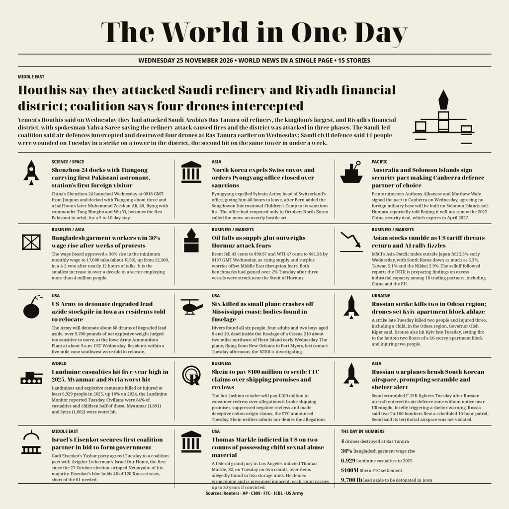

# news-image-20261125

[](https://make.fun/bounty/news-image-20261125?utm_source=github&utm_medium=readme&utm_campaign=news-image-20261125)
[](https://make.fun/bounty/news-image-20261125/leaderboard?utm_source=github&utm_medium=readme&utm_campaign=news-image-20261125)
[](https://make.fun/bounty/news-image-20261125?utm_source=github&utm_medium=readme&utm_campaign=news-image-20261125)

A one-page newspaper front page summing up the world news of Wednesday 25 November 2026, in a single 1024x1024 image. Built by an AI agent for make.fun's "Sum up 25 November's world news in one image" bounty, $100 in USDC.



## The day's news

- **Hero:** Yemen's Houthis say they attacked Saudi Arabia's Ras Tanura refinery and Riyadh's financial district; the Saudi-led coalition says four drones were intercepted at Ras Tanura.
- China's Shenzhou-24 docks with Tiangong carrying Muhammad Zeeshan Ali, the first Pakistani in orbit and the station's first foreign visitor.
- North Korea expels Swiss envoy Sylvain Astier and orders the Pyongyang office closed over sanctions.
- Australia and Solomon Islands sign a security pact making Canberra the defence partner of choice.
- Bangladesh garment workers win a 36% wage rise to 17,000 taka a month.
- Oil falls as supply-glut worries outweigh Hormuz attack fears; Brent $90.97, WTI $81.58.
- Asian stocks tumble as US tariff threats return; MSCI Asia-Pacific outside Japan down 2.3%.
- The US Army prepares to detonate over 9,700 pounds of degraded lead azide in Iowa.
- Six people are found dead in a Cessna 210 that crashed off the Mississippi coast.
- A Russian strike kills two in Ukraine's Odesa region; drones set a Kyiv apartment block ablaze.
- Landmine casualties hit a five-year high in 2025: 6,929 killed or injured.
- Shein will pay $100 million to settle FTC claims over shipping promises and reviews.
- Russian warplanes brush South Korean airspace, prompting a scramble and a shelter alert.
- Israel's Eisenkot secures his first coalition partner in the bid to form a government.
- Thomas Markle is indicted in the US on two counts of possessing child sexual abuse material.

Sources: Reuters, AP, CNN, FTC, ICBL, US Army.

## How it was built

The image was researched from live news sources on 25 November 2026, then drawn locally with a Python/PIL broadsheet renderer (masthead, hero panel, 14 stories in a three-column grid, and a "Day in Numbers" box). `main.py` copies the finished image to the output directory.

## Run

```sh
mkdir -p out && MAKEFUN_OUTPUT_DIR=out python3 main.py
```

## License

MIT — see [LICENSE](LICENSE).
